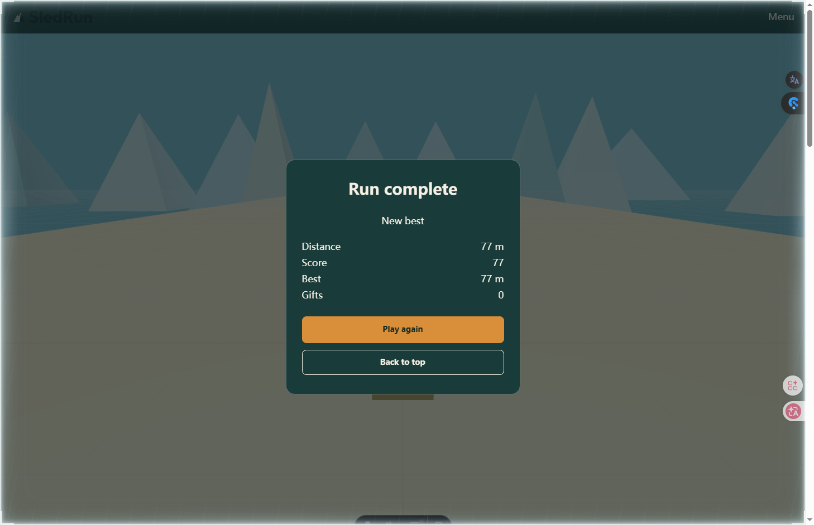

# SledRun

An original 3D snow sledding game for the browser.

**Play:** https://sledrun.pages.dev



## Three playable runs

| Run | What it is |
|---|---|
| **Sled Rider 3D** (`/`) | Classic endless snow run. Steer, jump, dodge trees and rocks, collect gifts. |
| **Snow Road 3D** (`/snow-road`) | A narrow icy road with denser hazards, inertia steering and perfect-section bonuses. |
| **3D Sledding** (`/3d-sledding`) | Steep downhill with jumps, flag gates and a combo multiplier. |

- Touch and keyboard, both first-class.
- Instant restart, local high scores, no accounts.
- No ads, no downloads, no signup.
- Original low-poly 3D assets; no third-party game iframes.

## Tech stack

- **Astro 7** static site generation
- **Three.js 0.187** with independent game bundles built by esbuild
- **TypeScript**
- **Cloudflare Pages + Functions + R2**
- Node **22.23.4**
- No React/Vue/Svelte runtime, no UI framework, no third-party font CDN

## Live

- Demo: **https://sledrun.pages.dev**
- Intended production domain: **https://sledrun.online** (custom-domain binding pending)

## Local development

```bash
npm ci
npm run dev
```

`npm run dev` watches the game bundles and runs Astro dev together.

## Build and check

```bash
npm run check        # astro check (prechecks game bundles)
npm run build        # game bundles + Astro static build
node scripts/check.mjs
```

The static output is written to `dist/`.

## Deploy

Direct Upload with Wrangler:

```powershell
powershell -ExecutionPolicy Bypass -File scripts/deploy-pages.ps1 -SyncR2 -InsecureTls
```

Or manually:

```bash
npm run build
npx wrangler pages deploy dist --project-name sledrun --branch main
```

- Pages project: `sledrun`
- R2 bucket: `sledrun-game-assets`
- R2 binding: `SLEDRUN_ASSETS`
- Game assets: `public/game/v1/**` → R2 keys `v1/**`
- `/game/*` is served by `functions/game/[[path]].ts`, R2 first with static fallback.

## Project structure

```text
src/
├── pages/          /, /snow-road, /3d-sledding, 404
├── components/     SiteHeader, SiteFooter, GameShell, SeoHead, JsonLd, FaqList
├── content/        page copy, FAQ, Schema data
├── games/
│   ├── engine/     Three.js engine, terrain, track, physics, VFX
│   ├── ui/         HUD, overlays, shell
│   ├── config/     per-mode gameplay and visual config
│   └── entries/    independent esbuild entry points
├── layouts/
└── styles/
functions/          Pages middleware + R2 game asset proxy
scripts/            build-game, dev, check, deploy
public/             icons, OG image, robots, sitemap
assets/             source and generated 3D assets
deploy/             R2 CORS config
docs/               launch checklist, check report, screenshots
```

## SEO and performance

- Static TDK, H1, body copy, FAQ, internal links and JSON-LD in the initial HTML.
- Sitemap, robots, real 404, no trailing slash; `/snow-road/` and `/3d-sledding/` 301 to the non-slash URL.
- Schema has no `aggregateRating`, `HowTo`, `SearchAction` or `LocalBusiness`.
- Local checks: 20/20 passed; local Lighthouse 95/98/97, LCP median 773.5 ms (local evidence only).
- Not yet verified: WebPageTest, mid-range Android INP/TTFB/frame rate, custom-domain TLS, GSC and rollback.

## Status

Playable MVP is deployed. Visual model/terrain refinement, custom-domain binding, GSC and full production acceptance are still in progress.

## Disclaimer

SledRun is an independent, fan-made project. It is not affiliated with, endorsed by, or sponsored by the creators of Snow Rider 3D, Sled Rider 3D, or any other game referenced on this site. All game names and trademarks belong to their respective owners. All games on SledRun are original works developed in-house unless otherwise stated.

## License

- **Code:** MIT — see `LICENSE`.
- **Original art, 3D assets, brand and screenshots:** all rights reserved — see `ASSETS_LICENSE.md`.
- Game titles referenced on the site are used descriptively only; all trademarks belong to their respective owners.
